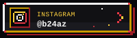
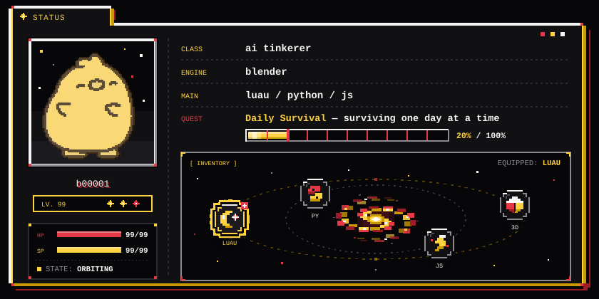
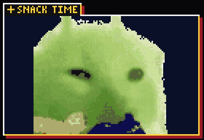

  

  
  

  

  
  

  

  

  <b>credits</b> · dancing duck pixelated from <a href="https://i.pinimg.com/originals/bb/6e/99/bb6e999e11cae9c0006f8abcde8001bf.gif">this gif on Pinterest</a>
  · alien cat &amp; dog pixelated from the Tenor memes
  <a href="https://media.tenor.com/PUSwyMUya2UAAAAM/green-alien-cat-green-alien-cat-meme.gif">green alien cat</a> and
  <a href="https://tenor.com/th/view/alien-cat-dancing-alien-dog-dancing-green-cat-dancing-green-dog-dancing-gif-7810733712102416021">alien cat &amp; dog dancing</a>

